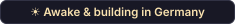

<!--
  ╔═════════════════<!--
  ╔══════════════════════════════════════════════════════════╗
  ║   ____                   _     _____ _                   ║
  ║  |  _ \ _   _ _ __ ___| |__ | ____(_)_ __  ___           ║
  ║  | | | | | | | '__/ __| '_ \|  _| | | '_ \/ __|          ║
  ║  | |_| | |_| | | | (__| | | | |___| | | | \__ \          ║
  ║  |____/ \__,_|_|  \___|_| |_|_____|_|_| |_|___/          ║
  ║                                                          ║
  ║  Thanks for inspecting the source! It's all okay. ✨     ║
  ╚══════════════════════════════════════════════════════════╝
-->

  <!-- Hero Banner (Scorpius & Ursa Minor) -->
  
   
  
   
  

 

<!-- PERSONAL BENTO BOX -->
<table>
  <tr>
    <td width="50%" valign="top">
      <h3>&nbsp;About Me</h3>
      

        I'm based in Germany with a passion for clean UI design, open-source software, and thoughtful Android apps — free from bloatware and trackers.
      

      

        I'm still early in my coding journey, learning step by step and using AI-assisted workflows to turn everyday ideas into real tools.
      

      

        
<i>The story behind <b>"DurchEins"</b> &amp; <b>n²/1</b></i>

         
        
          <b>DurchEins</b> (<i>"Divided by One"</i>) started as a reminder to stay true to myself. Then my partner came into my life — both our names start with <b>N</b>, making us a team: <b>N × N = n²</b>. Together that became <b>n²/1</b> in my bio, which mathematically stays whole no matter what. ❤️
        
      

    </td>
    <td width="50%" valign="top">
      <h3>&nbsp;Setup, Life &amp; Hobbies</h3>
      <ul>
        <li><b>First Place:</b> My Family &amp; Animals </li>
        <li><b>OS &amp; Tools:</b> Windows 11 &amp; Android (Studio)</li>
        <li><b>Hardware:</b> Google Pixel 9 Pro XL (Testing &amp; Daily)</li>
        <li><b>Focus:</b> AI-assisted workflows &amp; Privacy apps</li>
        <li><b>Hobbies:</b> Smart Home / Home Automation, The Sims 4, Google Ecosystem &amp; Artificial Intelligence</li>
        <li><b>Motto:</b> <i>Learn every day &amp; build step by step</i></li>
      </ul>
    </td>
  </tr>
</table>

  

<!-- FEATURED PROJECT -->
### &nbsp;Featured Project

<table>
  <tr>
    <td width="100%">
      <h3>
        
        
        
        
        &nbsp;<a href="https://github.com/DurchEins/apkup">ApkUp</a>
      </h3>
      

        <b>Modern Multi-Source App Updater</b> — An open-source, cryptographically verifying Android package manager crafted in <b>Material 3 Expressive</b>. Aggregates updates across Google Play, F-Droid, APKMirror, GitHub, GitLab &amp; Codeberg, including silent background installs via Shizuku.
      

      

        <a href="https://durcheins.github.io/apkup/"><b>Website</b></a> &nbsp;•&nbsp;
        <a href="https://github.com/DurchEins/apkup"><b>Source Code</b></a> &nbsp;•&nbsp;
        <a href="https://github.com/DurchEins/apkup/releases"><b>Download APKs</b></a>
      

    </td>
  </tr>
</table>

> **In the Lab:** *Experimenting behind the scenes with AI-powered document &amp; Google Drive workflows, desktop-to-Discord bridges, and Android automation.*

  

<!-- ECOSYSTEM & TOOLS -->
### &nbsp;Ecosystem &amp; Tools I Love

  
  
  
  
   
  
  
  
  

  

<!-- SPOTIFY EMBED THEME + ROTATING VINYL -->
### &nbsp;Vibe

  <a href="https://open.spotify.com"><picture><source media="(prefers-color-scheme: dark)" srcset="https://spotify-github-profile.kittinanx.com/api/view?uid=sobaba21&cover_image=true&theme=spotify-embed&mode=dark&show_offline=true&background_color=0d1117&interchange=false&bar_color=53b14f" /><source media="(prefers-color-scheme: light)" srcset="https://spotify-github-profile.kittinanx.com/api/view?uid=sobaba21&cover_image=true&theme=spotify-embed&mode=light&show_offline=true&background_color=ffffff&interchange=false&bar_color=53b14f" /></picture></a>

  

### &nbsp;Contribution Flow

  <picture>
    <source media="(prefers-color-scheme: dark)" srcset="https://raw.githubusercontent.com/DurchEins/DurchEins/output/github-contribution-grid-snake-dark.svg">
    <source media="(prefers-color-scheme: light)" srcset="https://raw.githubusercontent.com/DurchEins/DurchEins/output/github-contribution-grid-snake.svg">
    
  </picture>

  

<!-- SUPPORT SECTION -->
### &nbsp;Support My Work

  

    Enjoying my work? Leaving a ⭐ <b>Star</b> &amp; 👁️ <b>Watch</b> on <a href="https://github.com/DurchEins/apkup">ApkUp</a> — or hitting <b>Follow</b> on my <a href="https://github.com/DurchEins">profile</a> — is the best free way to support my journey!
  

  
  &nbsp;
  

  

<!-- HIDDEN EASTER EGG -->

  

    
&nbsp;Click for a random secret...

     
    If life were The Sims 4, I'd probably just type <code>testingcheats true</code> and <code>motherlode</code> — until then, I'll stick to debugging Kotlin &amp; drinking coffee. ☕✨
  

 

<!-- FOOTER -->

  Questions, ideas, or feedback? Join the <a href="https://github.com/DurchEins/apkup/discussions">Discussions</a> or open an <a href="https://github.com/DurchEins/apkup/issues">issue</a>.
    
  
  &nbsp;
  
  &nbsp;
  
    
  Built with  &amp; AI &nbsp;•&nbsp; <a href="#top">Back to top ↑</a>

════════════════════════════════════════╗
  ║   ____                   _     _____ _                   ║
  ║  |  _ \ _   _ _ __ ___| |__ | ____(_)_ __  ___           ║
  ║  | | | | | | | '__/ __| '_ \|  _| | | '_ \/ __|          ║
  ║  | |_| | |_| | | | (__| | | | |___| | | | \__ \          ║
  ║  |____/ \__,_|_|  \___|_| |_|_____|_|_| |_|___/          ║
  ║                                                          ║
  ║  Thanks for inspecting the source! It's all okay. ✨     ║
  ╚══════════════════════════════════════════════════════════╝
-->

  <!-- Custom Constellation Hero Banner (Scorpius & Ursa Minor) -->
  
    
  <!-- Terminal Prompt + Day/Night Status -->
  
    
  

 

<!-- PERSONAL BENTO BOX -->
<table>
  <tr>
    <td width="50%" valign="top">
      <h3>👋 Hey there!</h3>
      

        I'm from Germany with a strong passion for clean UI design, open-source software, and thoughtful Android apps — free from bloatware and trackers.
      

      

        Honestly, I'm still mostly at the beginning of my coding journey and have a lot left to learn. That's exactly what excites me: experimenting step by step, leveraging AI-assisted workflows, and building tools that solve real problems.
      

    </td>
    <td width="50%" valign="top">
      <h3>&nbsp;Setup, Life &amp; Hobbies</h3>
      <ul>
        <li><b>First Place:</b> My Family &amp; Animals </li>
        <li><b>OS &amp; Tools:</b> Windows 11 &amp; Android (Studio)</li>
        <li><b>Hardware:</b> Google Pixel 9 Pro XL (Testing &amp; Daily)</li>
        <li><b>Focus:</b> AI-assisted workflows &amp; Privacy apps</li>
        <li><b>Hobbies:</b> Smart Home / Home Automation, The Sims 4, Google Ecosystem &amp; Artificial Intelligence</li>
        <li><b>Motto:</b> <i>Learn every day &amp; build step by step</i></li>
      </ul>
    </td>
  </tr>
</table>

<!-- DEZENTE FLIP-CARD STORY -->

  

    
✨ <i>The story behind <b>"DurchEins"</b> &amp; <b>n²/1</b></i>

     
    
      <b>DurchEins</b> (literally <i>"Divided by One"</i>) started as a reminder to stay true to myself and keep my own balance. Then my partner came into my life — both of our names start with <b>N</b>, making us a team: <b>N × N = n²</b>. Together that turned into <b>n²/1</b> in my bio, which mathematically stays whole no matter what. A pretty neat coincidence! ❤️
    
  

  

<!-- FEATURED PROJECT -->
### 🚀 Featured Project

<table>
  <tr>
    <td width="100%">
      <h3>
        
        
        
        
        &nbsp;<a href="https://github.com/DurchEins/apkup">ApkUp</a>
      </h3>
      

        <b>Modern Multi-Source App Updater</b> — An open-source, cryptographically verifying Android package manager crafted in modern <b>Material 3 Expressive</b>. Aggregates updates across Google Play, F-Droid, APKMirror, GitHub, GitLab &amp; Codeberg, including silent background installs via Shizuku.
      

      

        <a href="https://durcheins.github.io/apkup/"><b>🌐 Visit Website →</b></a> &nbsp;|&nbsp;
        <a href="https://github.com/DurchEins/apkup"><b>💻 Explore Source →</b></a> &nbsp;|&nbsp; 
        <a href="https://github.com/DurchEins/apkup/releases"><b>⬇️ Releases &amp; APKs</b></a>
      

    </td>
  </tr>
</table>

<!-- IN THE LAB / UPCOMING -->
> **🧪 In the Lab / Upcoming:**  
> *Currently experimenting behind the scenes with AI-powered document &amp; Google Drive workflows, desktop-to-Discord bridges, and smart Android automation.*

  

<!-- ECOSYSTEM & TOOLS -->
### 🧭 Ecosystem &amp; Tools I Love

  
  
  
  
   
  
  
  
  

  

<!-- SPOTIFY EMBED THEME + ROTATING VINYL -->
### &nbsp;Vibe

  <a href="https://open.spotify.com"><picture><source media="(prefers-color-scheme: dark)" srcset="https://spotify-github-profile.kittinanx.com/api/view?uid=sobaba21&cover_image=true&theme=spotify-embed&mode=dark&show_offline=true&background_color=0d1117&interchange=false&bar_color=53b14f" /><source media="(prefers-color-scheme: light)" srcset="https://spotify-github-profile.kittinanx.com/api/view?uid=sobaba21&cover_image=true&theme=spotify-embed&mode=light&show_offline=true&background_color=ffffff&interchange=false&bar_color=53b14f" /></picture></a>

  

### ⚡ Contribution Flow

  <picture>
    <source media="(prefers-color-scheme: dark)" srcset="https://raw.githubusercontent.com/DurchEins/DurchEins/output/github-contribution-grid-snake-dark.svg">
    <source media="(prefers-color-scheme: light)" srcset="https://raw.githubusercontent.com/DurchEins/DurchEins/output/github-contribution-grid-snake.svg">
    
  </picture>

  

<!-- SUPPORT SECTION -->
### 💖 Support My Work

  

    Enjoying my work? Leaving a ⭐ <b>Star</b> &amp; 👁️ <b>Watch</b> on <a href="https://github.com/DurchEins/apkup">ApkUp</a> — or hitting <b>Follow</b> on my <a href="https://github.com/DurchEins">profile</a> — is the best free way to support my journey!
  

  
  &nbsp;
  

  

<!-- HIDDEN EASTER EGG -->

  

    
🔮 Click for a random secret...

     
    If life were The Sims 4, I'd probably just type <code>testingcheats true</code> and <code>motherlode</code> — until then, I'll stick to debugging Kotlin &amp; drinking coffee. ☕✨
  

 

<!-- FOOTER -->

  💬 Questions, ideas, or feedback? Join the <a href="https://github.com/DurchEins/apkup/discussions">Discussions</a> or open an <a href="https://github.com/DurchEins/apkup/issues">issue</a>!
    
  
  &nbsp;
  
  &nbsp;
  
    
  Built with  &amp; AI &nbsp;•&nbsp; <a href="#top">↑ Back to top</a>

